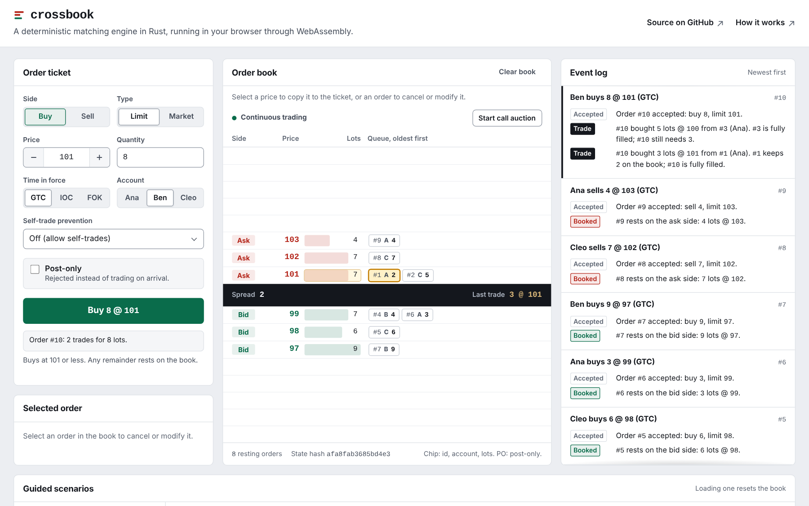

# crossbook

A limit order book and matching engine in Rust. It matches orders by price-time
priority, runs opening and closing call auctions, and reports every change to the
book as an ordered list of events. The engine crate has no dependencies, and the
same code compiles to WebAssembly for a browser playground.

[](https://github.com/ult666666/crossbook/actions/workflows/ci.yml)
[](LICENSE)
[](Cargo.toml)

In the [playground](https://ult666666.github.io/crossbook/) you can place orders
against a live book, step through guided scenarios and time a million synthetic
orders in your browser. The [case study](https://ult666666.github.io/projects/crossbook.html)
covers the design and the testing.



## Try it

With Rust 1.88 or newer:

```bash
git clone https://github.com/ult666666/crossbook
cd crossbook
cargo run --release -p crossbook-cli -- demo      # continuous trading
cargo run --release -p crossbook-cli -- auction   # an opening call and its uncross
```

Each step prints a one-line description and the events it produced:

```text
# A buy for 8 @ 101 takes the better price first, then the older order at 101
  accepted #4 buy 8 @ 101
  trade 5 @ 100 (taker #4, maker #3)
  trade 3 @ 101 (taker #4, maker #1)

# Fill-or-kill for 20 cannot fill in full, so it is rejected and nothing changes
  rejected #5: fill-or-kill order cannot fill in full
```

## What it does

Orders trade best price first and, at one price, oldest first. Every trade prints at
the resting order's price. The engine takes limit and market orders, with
good-till-canceled, immediate-or-cancel or fill-or-kill, plus post-only orders,
cancels and four self-trade prevention modes. A modified order keeps its place in the
queue only if its price stays and its quantity does not grow; otherwise it re-enters as
a new order.

A call phase collects orders without matching, as exchanges do before the open,
before the close and after a halt. The uncross then picks one clearing price by the
rules Xetra and Euronext publish: most volume, then the smallest surplus, then market
pressure, then the price nearest a reference. Every crossing order fills at that price
in price-time priority. During the call, `indicative_uncross()` reports the price,
volume and surplus an uncross would give at that moment.

Each command produces events (accepted, trade, booked, canceled, rejected, modified,
and for auctions call started, auction trade and uncrossed) in a defined order;
[docs/SEMANTICS.md](docs/SEMANTICS.md) is the contract. The engine reads no clock, draws
no random numbers and never iterates a hash map, so the same commands give the same
events on x86-64 Linux, ARM64 macOS, Windows and WebAssembly. CI checks all four.

The rest of the system is built on that event stream:

- Crash recovery replays a write-ahead journal on top of the newest checksummed
  snapshot, also in the middle of a call phase. A half-written last command is
  detected and skipped, and files from earlier versions still load.
- A market-data publisher derives trade prints and price-level updates from the events
  alone, with sequence numbers, gap detection and resynchronization.
- A sequencer, worker shards and an ordered merge spread many instruments across
  threads, and the output is the same for any number of shards.

## Use it as a library

```rust
use crossbook::{Command, Engine, Event, NewOrder, Side, TimeInForce};

let mut engine = Engine::new();
let mut events = Vec::new();

engine.process(&Command::New(NewOrder::limit(1, Side::Sell, 100, 10)), &mut events);
engine.process(
    &Command::New(NewOrder::limit(2, Side::Buy, 100, 15).tif(TimeInForce::Ioc)),
    &mut events,
);

// The IOC buy fills 10 lots and cancels the other 5 instead of resting.
assert!(engine.is_empty());
for event in &events {
    println!("{event}");
}
```

An auction: start a call phase, let orders cross without trading, read the indicative
uncross, then uncross and resume continuous trading.

```rust
use crossbook::{Command, Engine, NewOrder, Side, UncrossSummary};

let mut engine = Engine::new();
let mut events = Vec::new();
engine.process(&Command::StartCall { reference: Some(100) }, &mut events);
engine.process(&Command::New(NewOrder::limit(1, Side::Buy, 101, 8)), &mut events);
engine.process(&Command::New(NewOrder::limit(2, Side::Sell, 100, 5)), &mut events);

// 5 lots can trade at 100 or 101, with 3 left to buy at both: buyers press, so 101.
let summary = UncrossSummary { price: Some(101), volume: 5, imbalance_side: Some(Side::Buy), imbalance: 3 };
assert_eq!(engine.indicative_uncross(), summary);
engine.process(&Command::Uncross, &mut events);
engine.process(&Command::Resume, &mut events);
assert_eq!(engine.order(1).map(|order| order.remaining), Some(3));
```

## Command line

```bash
cargo run --release -p crossbook-cli -- bench --orders 5000000    # throughput and latency
cargo run --release -p crossbook-cli -- verify --orders 1000000   # fast engine vs reference model
cargo run --release -p crossbook-cli -- gen --out flow.xbk        # write a binary command journal
cargo run --release -p crossbook-cli -- gen --auctions --out day.xbk  # trading days with opening and closing auctions
cargo run --release -p crossbook-cli -- replay flow.xbk           # replay it and print fingerprints
cargo run --release -p crossbook-cli -- snapshot flow.xbk --at 400000 --out flow.xbs
cargo run --release -p crossbook-cli -- recover flow.xbk --snapshot flow.xbs   # rebuild after a crash
cargo run --release -p crossbook-cli -- feed                      # market data, checked against the book
cargo run --release -p crossbook-cli -- exchange                  # 64 instruments on 1 to 4 shard threads
cargo test --workspace                                            # all tests
```

## How it works

Price levels sit in one `BTreeMap` per side, so the best price is the first or last
key. Each level is a FIFO queue threaded through one slab of 48-byte order nodes with
`u32` links, which makes a cancel O(1) after the id lookup and reuses memory as orders
come and go. A call phase keeps the same structures: levels may cross, and market
orders wait in one queue per side. The uncross finds the clearing price in one pass
over the cached level totals. [docs/DESIGN.md](docs/DESIGN.md) covers the costs, the
auction rules with their sources, recovery, market data, sharding and the alternatives
considered.

## How it is tested

A second engine, `ReferenceEngine`, implements the same rules with linear scans and no
clever data structures. Property tests feed random command streams to both and require
the same events and the same book after every command, plus the fast engine's
structural invariants. For auctions, a brute-force uncross that tries every price
agrees with the engine on 20,000 random books, including ties at each rule.

Other tests cut the journal at a random byte and require recovery to reach the
uninterrupted run's state, rebuild the book from the market-data feed after every
command, and run multi-instrument streams on random shard counts. Digests of long
sessions are pinned and must match on all three CI operating systems and in
WebAssembly. Mutation testing with cargo-mutants checks that the suite fails when the
code is broken on purpose. [docs/TESTING.md](docs/TESTING.md) has each layer, the case
counts and the surviving mutants.

## Performance

| Measure | Result |
| --- | --- |
| Throughput on one core | 15 to 16 million commands per second |
| Latency per command, p50 / p99 | 64 ns / 196 ns |
| The same engine in WebAssembly, under Node.js | about 8.3 million commands per second |
| Uncross of a closing call with 8,452 orders | about 54 µs for 1,608 fills |
| 64 instruments on a 4-core VM | 2.6 to 3.4 times one thread, with 3 or 4 shards |

These time the matching core on synthetic order flow on cloud VMs, with no network,
parsing or persistence on the timed path. [docs/BENCHMARKS.md](docs/BENCHMARKS.md)
has the machines, the commands and the full tables.

## Project layout

| Path | Contents |
| --- | --- |
| `crates/crossbook` | The engine and call auctions, the reference model, codec, journal, snapshots and recovery, market data, the sharded runner, synthetic flow, tests and benchmarks |
| `crates/crossbook-cli` | The `crossbook` command: `demo`, `auction`, `bench`, `verify`, `gen`, `replay`, `snapshot`, `recover`, `feed`, `exchange` |
| `crates/crossbook-wasm` | WebAssembly bindings used by the playground |
| `web/` | The browser playground (static HTML, CSS and JavaScript) |
| `docs/` | Semantics, design, testing and benchmark notes; release notes are in [CHANGELOG.md](CHANGELOG.md) |

## Limits

- Each book holds one instrument in memory, and there is no network gateway,
  authentication or pre-trade risk check.
- The CLI writes journals without `fsync`, so recovery shows the protocol rather than
  a tuned storage layer.
- The clearing price is always an order's limit (or the reference price for a book of
  market orders), where Xetra would use the reference price itself when it falls
  between two candidates.
- There are no volatility interruptions or price bands, and the feed does not publish
  the indicative price during a call.
- All order flow is synthetic, and nothing here connects to a market.

Built with AI coding assistants. The tests and CI checks described above verify its
behavior.

## License

[MIT](LICENSE)
