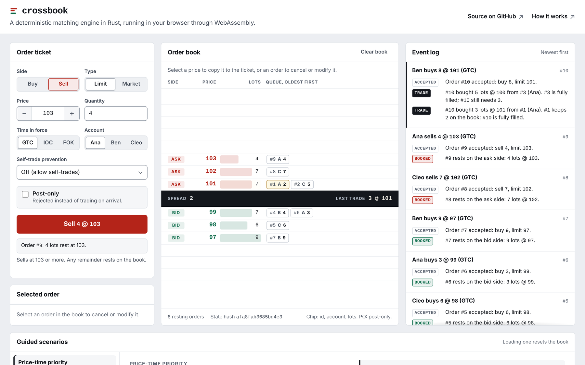

# crossbook

A limit order book and matching engine in Rust: price-time priority, the order types
real venues use, and a deterministic event stream, checked against a second
implementation and compiled to WebAssembly so it runs in your browser.

[](https://github.com/ult666666/crossbook/actions/workflows/ci.yml)
[](LICENSE)
[](Cargo.toml)

**[Open the playground](https://ult666666.github.io/crossbook/)**: place orders against a
live book, step through guided scenarios, and run a million synthetic orders in your
browser.



## What it does

- **Price-time priority.** Better prices trade first; at one price, earlier orders trade
  first. Every trade prints at the resting order's price.
- **Order types.** Limit and market; good-till-canceled, immediate-or-cancel and
  fill-or-kill; post-only; cancel; modify with explicit queue-priority rules; four
  self-trade prevention modes.
- **Events, not state.** Each command emits a precise, ordered list of events: accepted,
  trade, booked, canceled, rejected, modified. The full contract is in
  [docs/SEMANTICS.md](docs/SEMANTICS.md).
- **Deterministic.** The same commands produce the same events on x86-64 Linux, ARM64
  macOS, Windows and WebAssembly. CI checks all four.
- **Small.** The engine crate has no dependencies and no `unsafe` code.

## Results

| | |
| --- | --- |
| Throughput, one core, synthetic flow | 15 to 16 million commands per second |
| Latency per command, p50 / p99 / p99.9 | 64 ns / 196 ns / 477 ns |
| Same session compiled to WebAssembly (Node.js) | about 8.3 million commands per second, with the same event digest and state hash as the native build |
| Differential tests against the reference model | 1,024 random command streams per local run, 4,096 in CI, plus a one-million-command check |
| Mutation testing (cargo-mutants) | 140 of 148 compiling mutants caught. Of the 8 survivors, 4 are now covered by new assertions, 2 pointed at redundant code that was deleted, and 2 only drop a capacity hint |

Measured on a 2.1 GHz Intel Xeon cloud VM, one pinned core, Rust 1.97 (medians of three seeds, 5 million commands each) with the commands in [docs/BENCHMARKS.md](docs/BENCHMARKS.md).
The matching core only: no network, parsing or persistence on the timed path.

## Quick start

Needs Rust 1.88 or newer.

```bash
git clone https://github.com/ult666666/crossbook
cd crossbook
cargo run --release -p crossbook-cli -- demo
```

The demo walks through a short session:

```text
# A buy for 8 @ 101 takes the better price first, then the older order at 101
  accepted #4 buy 8 @ 101
  trade 5 @ 100 (taker #4, maker #3)
  trade 3 @ 101 (taker #4, maker #1)

# Fill-or-kill for 20 cannot fill in full, so it is rejected and nothing changes
  rejected #5: fill-or-kill order cannot fill in full
```

Other commands:

```bash
cargo run --release -p crossbook-cli -- bench --orders 5000000    # throughput and latency
cargo run --release -p crossbook-cli -- verify --orders 1000000   # fast engine vs reference model
cargo run --release -p crossbook-cli -- gen --out flow.xbk        # write a binary command journal
cargo run --release -p crossbook-cli -- replay flow.xbk           # replay it and print fingerprints
cargo test --workspace                                            # all tests
```

## Use it as a library

```rust
use crossbook::{Command, Engine, Event, NewOrder, Side, TimeInForce};

let mut engine = Engine::new();
let mut events = Vec::new();

engine.process(&Command::New(NewOrder::limit(1, Side::Sell, 100, 10)), &mut events);
engine.process(
    &Command::New(NewOrder::limit(2, Side::Buy, 100, 15).tif(TimeInForce::Ioc)),
    &mut events,
);

// The IOC buy fills 10 lots and cancels the other 5 instead of resting.
assert!(engine.is_empty());
for event in &events {
    println!("{event}");
}
```

## How it is checked

- **Scenario tests** pin every rule in the spec to exact events.
- **Differential testing.** A second, deliberately naive engine implements the same rules
  with linear scans. Property tests feed random command streams to both and require
  identical events and books after every command, plus structural invariants and
  quantity conservation.
- **Golden digests.** A 64-bit fingerprint of a 100,000-command session is pinned in the
  tests and must match on every CI platform and in WebAssembly.
- **Mutation testing** confirms the tests fail when the engine is broken on purpose.

Details: [docs/TESTING.md](docs/TESTING.md).

## How it works

Price levels sit in one `BTreeMap` per side, so the best price is the first or last key.
Each level is a FIFO queue threaded through a single slab of 48-byte order nodes with
`u32` links, which makes cancel O(1) after the id lookup and reuses memory as orders come
and go. The engine never reads a clock or a random number generator and never iterates a
hash map, which is what makes it deterministic. Design notes, costs and the alternatives
considered: [docs/DESIGN.md](docs/DESIGN.md).

## Project layout

| Path | Contents |
| --- | --- |
| `crates/crossbook` | The engine, the reference model, binary codec, journal, synthetic flow, tests and benchmarks |
| `crates/crossbook-cli` | The `crossbook` command: `demo`, `bench`, `verify`, `gen`, `replay` |
| `crates/crossbook-wasm` | WebAssembly bindings used by the playground |
| `web/` | The browser playground (static HTML, CSS and JavaScript) |
| `docs/` | Semantics, design, testing and benchmark notes |

## Scope

crossbook is a learning and benchmarking project, not an exchange. It handles one
instrument in memory, has no network gateway, and runs only on synthetic data. It is not
connected to any market. Developed with AI assistance; the tests, CI checks and
benchmark commands above are the evidence for each claim in this README.

## License

[MIT](LICENSE)
