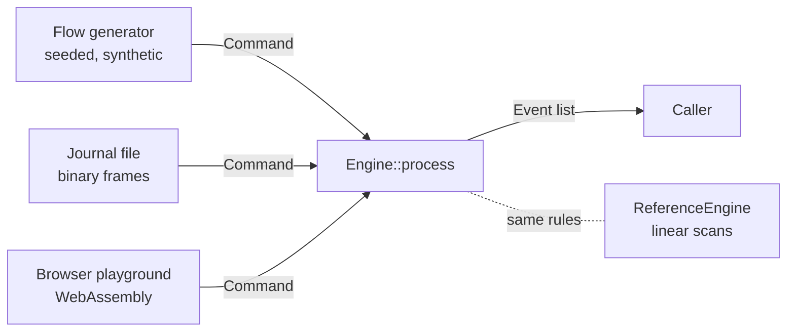

# Design

crossbook is a single-instrument limit order book with price-time priority matching.
This document explains how it is built and why. The exact matching rules are in
[SEMANTICS.md](SEMANTICS.md); how they are checked is in [TESTING.md](TESTING.md).

## Goals, in order

1. **Correct.** Every rule is written down, tested by scenario, and cross-checked against
   a second implementation.
2. **Deterministic.** The same commands produce the same events and the same book on any
   machine, including WebAssembly in a browser.
3. **Fast enough to matter.** Tens of millions of commands per second on one core, with
   latency measured per command, so data-structure choices show up in the numbers.
4. **Small and readable.** One library crate with no dependencies and no `unsafe`.

## Shape of the system



- `Engine::process(&Command, &mut Vec<Event>)` is the whole interface. It reads one
  command, updates the book, and appends events to a buffer the caller owns. A session
  reuses one buffer, so steady-state processing does not allocate per event.
- `ReferenceEngine` implements the same rules as simply as possible. It exists only to
  check `Engine`.
- `codec` and `journal` give commands a fixed binary layout, so a session can be saved
  and replayed.
- `flow` generates realistic synthetic command streams for tests, benchmarks and the
  playground.

## Data structures

```text
bids: BTreeMap<Price, Level>          asks: BTreeMap<Price, Level>
          │                                      │
          ▼                                      ▼
   Level { head, tail, total, count }     (best ask = first key,
          │                                best bid = last key)
          ▼
   slab: Vec<Node>   Node { id, account, price, remaining, priority, prev, next, ... }
          ▲
          │
   index: HashMap<OrderId, u32>         free list: Vec<u32>
```

- **Price levels** live in one `BTreeMap` per side. The best ask is the first key and the
  best bid is the last, and walking the map visits levels in priority order, which is
  exactly what a sweep needs.
- **Orders** are nodes in a single slab (`Vec<Node>`). Each level is a doubly linked FIFO
  queue threaded through the slab with `u32` indices. Appending to a level and removing
  any node are O(1), so a cancel from the middle of a long queue costs the same as a
  cancel at the front. Freed slots go on a free list and are reused, so a long session
  does not keep growing the slab.
- **Ids** map to slab slots through a hash map with a small multiplicative hasher
  (FxHash with a final fold). Order ids are trusted input here. A gateway facing untrusted
  clients would assign ids itself or use a keyed hasher, because a fixed hash function
  lets an attacker choose colliding ids.
- **Levels cache** their total quantity and order count, so depth queries do not walk
  queues.

`u32` links keep a node at 48 bytes (a test pins the size) and give a free sentinel value
(`u32::MAX`).
The slab therefore holds fewer than 2<sup>32</sup> orders, which is far beyond anything a
single in-memory book needs.

### Costs

L is the number of price levels on a side, k the number of fills, m the orders a
fill-or-kill check walks.

| Operation | Cost |
| --- | --- |
| New passive order | O(log L) to find or create the level, O(1) to append |
| New aggressive order | O(log L) per price level touched, O(1) per fill: O((levels touched) log L + k) |
| Cancel | O(1) id lookup and unlink, O(log L) to update the level |
| Modify keeping priority | O(1) lookup, O(log L) level update |
| Fill-or-kill check | O(m) read-only walk before any change |
| Best bid or ask | O(log L) |
| Depth of n levels | O(n + log L) |

## Why not something else

**A `VecDeque` per level.** Simple, and fine for the front of the queue, but cancelling
an order in the middle is O(queue length). Cancels are the most common message in real
order flow, so the intrusive list wins.

**A dense price ladder** (an array indexed by price offset). Level lookup becomes O(1)
and the CPU cache likes it, but it needs a bounded price band, a rebasing story when the
market moves out of it, and a scan to find the next best price after a level empties.
The tree keeps the code general. With about 30 to 45 active levels per side in the
synthetic flow, tree depth is small; a ladder is the natural next experiment, and the benchmark
harness exists to measure it honestly.

**Several threads.** Matching for one instrument is sequential by definition: each
order's outcome depends on every order before it. Exchanges scale by sequencing input
on one thread per instrument (or per partition) and spreading instruments across cores.
Network I/O, risk checks and market data would sit around this core on other threads;
they are out of scope here.

## Determinism

The engine's output depends only on its input commands:

- no clocks: time priority is a counter that increments when an order is booked;
- no randomness;
- no iteration over hash maps (the id index is only used for lookups);
- integer arithmetic only, with no floating point anywhere in the engine or generator;
- the flow generator uses its own SplitMix64 PRNG and integer math, so a seed yields
  the same stream on every platform.

To make this checkable, `digest::Fingerprint` hashes events and books with FNV-1a over an
explicit little-endian encoding. It deliberately avoids `std::hash`, whose output is not
guaranteed to stay the same across Rust releases. CI pins the fingerprints of a 100,000
command session on x86-64 Linux, ARM64 macOS and x86-64 Windows, and compares a
1,000,000 command session between the native build and the WebAssembly build.

## Overflow

Quantities are `u64`, but one order is capped at `MAX_QTY = u32::MAX` lots, and the slab
holds fewer than `u32::MAX` orders. A level's total is therefore below
(2<sup>32</sup>)<sup>2</sup> = 2<sup>64</sup>, so cached totals cannot overflow. Prices
are never added or multiplied by the engine.

## Events as the interface

The engine never returns "the order's new state". It emits facts: accepted, traded,
booked, canceled, rejected, modified. Downstream consumers (a gateway sending execution
reports, a market-data publisher, an audit log) can each be built from that stream, and
two engines can be compared event by event. The order of events within one command is
part of the contract, which is why the differential tests compare whole event lists, not
just final books.

## What a production system would add

This is a teaching and benchmarking project, not an exchange. A real venue also needs:
durable sequencing of input before matching, snapshots plus journal replay for recovery,
pre-trade risk checks, market-data dissemination, multiple instruments, auctions and
halts, price bands, fees, and operational controls such as kill switches. The event-based
interface and the determinism guarantees are what make those pieces straightforward to
add around this core.
