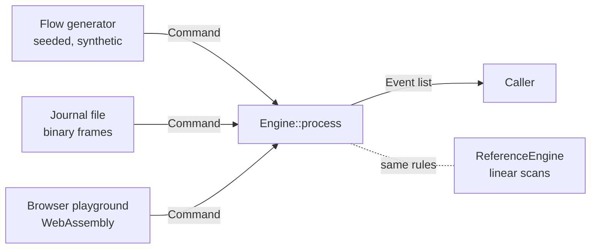
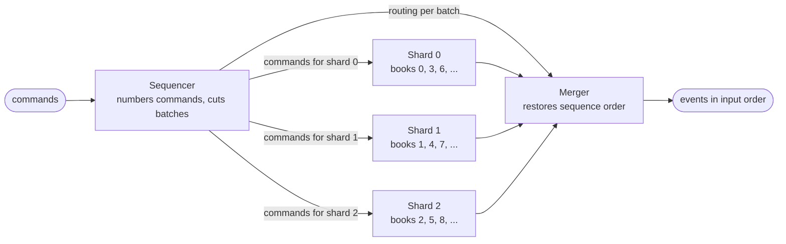

# Design

crossbook is a single-instrument limit order book with price-time priority matching.
This document explains how it is built and why. The exact matching rules are in
[SEMANTICS.md](SEMANTICS.md); how they are checked is in [TESTING.md](TESTING.md).

## Goals, in order

1. **Correct.** Every rule is written down, tested by scenario, and cross-checked against
   a second implementation.
2. **Deterministic.** The same commands produce the same events and the same book on any
   machine, including WebAssembly in a browser.
3. **Fast enough to matter.** Tens of millions of commands per second on one core, with
   latency measured per command, so data-structure choices show up in the numbers.
4. **Small and readable.** One library crate with no dependencies and no `unsafe`.

## Shape of the system



- `Engine::process(&Command, &mut Vec<Event>)` is the whole interface. It reads one
  command, updates the book, and appends events to a buffer the caller owns. A session
  reuses one buffer, so steady-state processing does not allocate per event.
- `ReferenceEngine` implements the same rules as simply as possible. It exists only to
  check `Engine`.
- `codec` and `journal` give commands a fixed binary layout, so a session can be saved
  and replayed.
- `flow` generates realistic synthetic command streams for tests, benchmarks and the
  playground.

## Data structures

```text
bids: BTreeMap<Price, Level>          asks: BTreeMap<Price, Level>
          │                                      │
          ▼                                      ▼
   Level { head, tail, total, count }     (best ask = first key,
          │                                best bid = last key)
          ▼
   slab: Vec<Node>   Node { id, account, price, remaining, priority, prev, next, ... }
          ▲
          │
   index: HashMap<OrderId, u32>         free list: Vec<u32>
```

- **Price levels** live in one `BTreeMap` per side. The best ask is the first key and the
  best bid is the last, and walking the map visits levels in priority order, which is
  exactly what a sweep needs.
- **Orders** are nodes in a single slab (`Vec<Node>`). Each level is a doubly linked FIFO
  queue threaded through the slab with `u32` indices. Appending to a level and removing
  any node are O(1), so a cancel from the middle of a long queue costs the same as a
  cancel at the front. Freed slots go on a free list and are reused, so a long session
  does not keep growing the slab.
- **Ids** map to slab slots through a hash map with a small multiplicative hasher
  (FxHash with a final fold). Order ids are trusted input here. A gateway facing untrusted
  clients would assign ids itself or use a keyed hasher, because a fixed hash function
  lets an attacker choose colliding ids.
- **Levels cache** their total quantity and order count, so depth queries do not walk
  queues.

`u32` links keep a node at 48 bytes (a test pins the size) and give a free sentinel value
(`u32::MAX`).
The slab therefore holds fewer than 2<sup>32</sup> orders, which is far beyond anything a
single in-memory book needs.

### Costs

L is the number of price levels on a side, k the number of fills, m the orders a
fill-or-kill check walks.

| Operation | Cost |
| --- | --- |
| New passive order | O(log L) to find or create the level, O(1) to append |
| New aggressive order | O(log L) per price level touched, O(1) per fill: O((levels touched) log L + k) |
| Cancel | O(1) id lookup and unlink, O(log L) to update the level |
| Modify keeping priority | O(1) lookup, O(log L) level update |
| Fill-or-kill check | O(m) read-only walk before any change |
| Best bid or ask | O(log L) |
| Depth of n levels | O(n + log L) |

## Why not something else

**A `VecDeque` per level.** Simple, and fine for the front of the queue, but cancelling
an order in the middle is O(queue length). Cancels are the most common message in real
order flow, so the intrusive list wins.

**A dense price ladder** (an array indexed by price offset). Level lookup becomes O(1)
and the CPU cache likes it, but it needs a bounded price band, a rebasing story when the
market moves out of it, and a scan to find the next best price after a level empties.
The tree keeps the code general. With about 30 to 45 active levels per side in the
synthetic flow, tree depth is small; a ladder is the natural next experiment, and the benchmark
harness exists to measure it honestly.

**Several threads.** Matching for one instrument is sequential by definition: each
order's outcome depends on every order before it. Exchanges scale by sequencing input
on one thread per instrument (or per partition) and spreading instruments across cores.
Network I/O, risk checks and market data would sit around this core on other threads;
they are out of scope here.

## Determinism

The engine's output depends only on its input commands:

- no clocks: time priority is a counter that increments when an order is booked;
- no randomness;
- no iteration over hash maps (the id index is only used for lookups);
- integer arithmetic only, with no floating point anywhere in the engine or generator;
- the flow generator uses its own SplitMix64 PRNG and integer math, so a seed yields
  the same stream on every platform.

To make this checkable, `digest::Fingerprint` hashes events and books with FNV-1a over an
explicit little-endian encoding. It deliberately avoids `std::hash`, whose output is not
guaranteed to stay the same across Rust releases. CI pins the fingerprints of a 100,000
command session on x86-64 Linux, ARM64 macOS and x86-64 Windows, and compares a
1,000,000 command session between the native build and the WebAssembly build.

## Overflow

Quantities are `u64`, but one order is capped at `MAX_QTY = u32::MAX` lots, and the slab
holds fewer than `u32::MAX` orders. A level's total is therefore below
(2<sup>32</sup>)<sup>2</sup> = 2<sup>64</sup>, so cached totals cannot overflow. Prices
are never added or multiplied by the engine.

## Events as the interface

The engine never returns "the order's new state". It emits facts: accepted, traded,
booked, canceled, rejected, modified. Downstream consumers (a gateway sending execution
reports, a market-data publisher, an audit log) can each be built from that stream, and
two engines can be compared event by event. The order of events within one command is
part of the contract, which is why the differential tests compare whole event lists, not
just final books.

## Snapshots and recovery

The engine's state is a function of its input, so durability comes down to keeping the
input. The protocol is write-ahead logging: a command is appended to the journal before
the engine applies it, and a snapshot records how many journaled commands its book
includes. `recovery::recover` loads the newest snapshot, skips that many commands in the
journal and replays the rest. Because replay is deterministic, it emits the events the
lost process emitted and ends in the same book.

A snapshot stores every resting order in book order with its time priority, plus the
engine's priority counter. Queue order alone would reproduce the events, but storing the
exact priorities makes a restored engine indistinguishable from the original: its next
snapshot is byte-identical, which the tests check. The format is a 32-byte header,
40 bytes per order and an FNV-1a checksum over everything before it. The checksum
catches damage. `snapshot::decode` also refuses any book the engine could not have
produced (unknown codes, a crossed book, levels or queues out of order, duplicate ids or
priorities, a priority newer than the clock), so a snapshot from a buggy writer fails at
load time instead of becoming a corrupt live book.

Recovery distinguishes two failures. A crash in the middle of an append leaves a torn
final frame: the input ends inside a frame. That command was never applied, so recovery
stops before it and reports the intact length, which is where the next append must
start. Any other decode failure, or a snapshot that claims more commands than the
journal holds, is corruption, and recovery stops with an error instead of guessing.

Recovery finds the tail by counting frames rather than storing a byte offset in the
snapshot. Counting decodes the skipped frames, which costs time on very long journals,
but it keeps snapshots independent of the journal's layout, and skipping and replaying
a million commands takes about 0.15 s. The CLI writes journals without `fsync`, so it
shows the protocol rather than a tuned storage layer; a venue would add `fsync` or group
commit and rotate journals at each snapshot.

## Market data from events

Exchanges publish trades and the total quantity at each price (market by price). The
publisher in `market_data` builds both from the event stream alone: it keeps its own
record of every resting order from `Booked`, `Trade`, `Canceled` and `Modified` events
and never reads the engine. That keeps publishing work off the matching path, lets the
publisher run on a replica that only sees the event log, and tests the claim that the
events describe every change to the book completely.

For each command the publisher sends the trade prints in the order they happened, then
one message per price level the command changed, with the level's new totals, bids
first and best price first. Coalescing per command means a level touched several times
by one sweep produces one message, and the sort makes the feed a deterministic function
of the commands. On synthetic flow the feed averages 1.16 messages per command.

The subscriber, `BookBuilder`, applies messages in sequence order. A sequence number
ahead of the expected one is a gap; a heartbeat that announces the latest sequence
number catches a gap at the end of a quiet period. After a gap the builder refuses
messages until it resynchronizes from a snapshot of the publisher's levels, and it
ignores messages the snapshot already includes, so buffered messages can be replayed
safely.

## Many instruments: sequencer, shards and merger

One book must process its commands one at a time, but different instruments are
independent. `exchange::run` therefore parallelizes across instruments, not within a
book:



Each instrument belongs to exactly one shard and each shard processes its commands in
arrival order, so every book sees the same commands in the same order as on one thread.
The merger follows each batch's routing to put the shards' outputs back in input order.
The result is identical for any number of shards and any batch size; the property tests
check this for random streams and random settings, and CI checks it on synthetic flow
on Linux, macOS and Windows.

Queues are bounded, so a slow consumer slows the sequencer instead of growing memory.
Batching plus bounded queues can deadlock an ordered merge: if the merger waits for a
command that sits in a batch the sequencer has not sent yet, while the sequencer waits
for room in a full queue, nothing moves. Here a batch is a run of consecutive commands
that is sent in full before the next one starts, and the merger always waits for the
oldest unfinished batch, whose commands are already queued at the shards ahead of any
later work. Some thread can therefore always make progress. Buffers travel in a loop
(command parts back to the sequencer, event parts back to their shard, routes back to
the sequencer) instead of being allocated per batch, and returns never block, so they
add no waiting.

Measured on a 4-core cloud VM with 64 instruments of about 2,000 resting orders each
(see [BENCHMARKS.md](BENCHMARKS.md#many-instruments)): one thread processing every book
manages about 3.3 million commands per second, because 64 deep books do not fit in one
core's cache. One shard is 13 to 18% slower than that, which is the cost of copying
commands and handing batches between threads. Two shards reach 1.6 to 1.7 times the
single thread, and three or four shards 2.6 to 3.4 times, as the books spread over
several cores' caches. Three or four shards plus the sequencer and the merger need more
threads than the machine has cores, so those results vary the most. The sequencer and
merger are serial stages, so they bound the speedup however many shards run.

## What a production system would add

This is a learning and benchmarking project, not an exchange. A real venue also needs:
a network gateway with authentication and pre-trade risk checks, a replicated sequencer
so a standby can take over, `fsync` policies and journal rotation, auctions and halts,
price bands, fees, and operational controls such as kill switches. Recovery, market data
and multi-instrument sharding above show how the event-based interface and the
determinism guarantees carry those pieces: each is built around the core without
changing how it matches.
